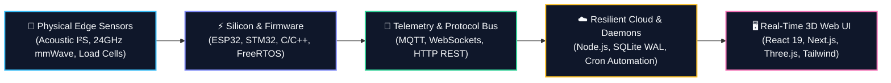

<div align="center">

<!-- HEADER BANNER -->


<!-- TYPING SVG SUBTITLE -->
<a href="https://my-portfolio-sigma-two-65.vercel.app/">
  
</a>

<br/>

<!-- BADGES BAR -->
[](https://my-portfolio-sigma-two-65.vercel.app/)
[](https://www.linkedin.com/in/abhishek-gaur-855a3b388)
[](mailto:gaurabhishek2309@gmail.com)
[](https://rru.ac.in/)
[](https://github.com/abhi23gaur07)

</div>

---

### ⚡ Executive Summary

> **"Full Stack & Embedded IoT Developer bridging physical hardware and web applications. Experienced in developing responsive, real-time dashboards and interfacing microcontrollers with scalable cloud backends using modern JavaScript, C/C++, and IoT protocols. Committed to building robust, data-driven connected products that deliver measurable real-world impact."**

```
┌────────────────────────────────────────────────────────────────────────┐
│  "Be a living electronic circuit:                                      │
│   • Practice resistance where needed, like a Resistor.                 │
│   • Preserve energy where needed, like a Capacitor.                    │
│   • Direct energy where needed, like a Diode.                          │
│   • And above all, be driven by a purpose, like an Integrated Circuit." │
└────────────────────────────────────────────────────────────────────────┘
```

---

### 🔭 Engineering Focus & Radar

| Field | Details |
|---|---|
| 🔭 **I’m currently working on** | Scalable IoT systems & full-stack web dashboards connecting smart hardware (ESP32 / Arduino / ARM) with modern cloud APIs. |
| 👯 **I’m looking to collaborate on** | Open-source IoT frameworks, smart automation solutions, and data-driven full-stack applications. |
| 🤝 **I’m looking for help with** | Advanced RTOS concepts, edge computing optimization, and large-scale MQTT / WebSocket pipeline architectures. |
| 🌱 **I’m currently learning** | Embedded C/C++ architecture, MQTT broker integrations, and Next.js for high-performance dashboard interfaces. |
| 💬 **Ask me about** | Sensor integration, microcontrollers (ESP32, Arduino), RESTful IoT backends, and React-driven 3D control dashboards. |
| ⚡ **Fun fact** | I enjoy making hardware and software talk to each other — turning raw physical sensor signals into real-time web metrics is pure magic! |

---

### 🏆 Key Honors & Recognitions

- 🥇 **Rank #1 in Hardware Category** — *Smart India Hackathon (SIH) Internal Round*, Rashtriya Raksha University.
- 🏅 **Rank #8 Overall Category** — Out of 64 top competing engineering teams across the university.
- 🎖️ **Top ECE Innovator** — *RRU Engineering & Technology Innovation Showcase* (Edge IoT & public safety telemetry).
- 🌟 **Social Innovation Recognition** — *Assistive Healthcare Engineering Initiative for NER Dementia Patients*.

---

### 🛠️ Hardware-to-Cloud Workflow



---

### 🚀 Flagship Engineered Projects

<table>
  <tr>
    <td width="50%" valign="top">
      <h3 align="center">💧 Aqua Saviour</h3>
      <p align="center">
        <b>AI-Powered Underground Pipeline Crack & Leakage Detector</b><br/>
        <a href="https://github.com/abhi23gaur07/AQUA-SAVIOUR"><code>Repo</code></a> • 
        <a href="https://aqua-saviour-iota.vercel.app"><code>Live Demo</code></a>
      </p>
      <ul>
        <li><b>Acoustic Time-of-Flight (ToF)</b>: Pinpoints buried water main fractures with $\le \pm 15\text{ cm}$ precision without destructive road excavation.</li>
        <li><b>Edge Hardware</b>: Solar-powered ESP32-WROOM-32D nodes clamped with INMP441 I²S MEMS hydrophones & NEO-6M GPS modules at ~₹1,010/node.</li>
        <li><b>3D GIS Command Center</b>: 10-portal React 19 + Three.js/WebGL cutaway with live Open-Meteo & NASA POWER SMAP soil moisture heatmaps.</li>
      </ul>
      <p align="center">
        
        
        
        
      </p>
    </td>
    <td width="50%" valign="top">
      <h3 align="center">🏠 Nexus Nurture</h3>
      <p align="center">
        <b>3D Smart Home & Edge Energy Automation Platform</b><br/>
        <a href="https://github.com/abhi23gaur07/NEXUS-NURTURE"><code>Repo</code></a> • 
        <a href="https://nexus-nurture-lake.vercel.app"><code>Live Demo</code></a>
      </p>
      <ul>
        <li><b>Spatial mmWave Radar & Load Cells</b>: 24GHz presence & micro-motion angle tracking fused with furniture load cells.</li>
        <li><b>Edge HVAC Optimization</b>: Deterministic ESP32 state machines driving motorized servo louvers (Target Follow & Indirect Coanda modes), cutting energy use by up to <b>38%</b>.</li>
        <li><b>3D Digital Twin</b>: Real-time room telemetry (Temp, Humidity, CO₂, RSSI), sleep biometrics, and Siri / Voice shortcuts.</li>
      </ul>
      <p align="center">
        
        
        
        
      </p>
    </td>
  </tr>
  <tr>
    <td width="50%" valign="top">
      <h3 align="center">🧠 Delta Neurons</h3>
      <p align="center">
        <b>AI-Assisted Cognitive Healthcare Platform for NER</b><br/>
        <a href="https://github.com/abhi23gaur07/DELTA-NEURONS-"><code>Repo</code></a> • 
        <a href="https://delta-neurons.vercel.app"><code>Live Demo</code></a>
      </p>
      <ul>
        <li><b>100% Offline-First Engine</b>: Local storage buffer queue ensuring elderly dementia patients can play cognitive exercises even with zero connectivity.</li>
        <li><b>Linguistic & Sensory Localization</b>: Curated for India's North Eastern Region with Assamese language support and folk reminiscence stimuli.</li>
        <li><b>Tri-Role Ecosystem</b>: Accessible patient gaming UI, caregiver logs, and doctor telemetry for cognitive regression tracking.</li>
      </ul>
      <p align="center">
        
        
        
        
      </p>
    </td>
    <td width="50%" valign="top">
      <h3 align="center">📚 The Smart Library</h3>
      <p align="center">
        <b>Automated Circulation & WhatsApp Reminder Engine</b><br/>
        <a href="https://github.com/abhi23gaur07/the-smart-library"><code>Repo</code></a> • 
        <a href="https://github.com/abhi23gaur07/the-smart-library"><code>Documentation</code></a>
      </p>
      <ul>
        <li><b>Automated Notification Cron</b>: Background daemon triggering instant WhatsApp reminders for overdue books, reducing late returns by <b>60%+</b>.</li>
        <li><b>High-Concurrency Architecture</b>: Built on SQLite in WAL mode with sub-50ms query latency for campus-wide load spikes.</li>
        <li><b>Institutional Features</b>: 48-hour automated reservation expiration, 3-tier RBAC (Student, Librarian, Admin), and catalog search.</li>
      </ul>
      <p align="center">
        
        
        
        
      </p>
    </td>
  </tr>
</table>

---

### 💻 Technical Arsenal & Tech Stack

<div align="center">

#### Embedded Systems & Hardware


#### Circuit Design, Buses & Protocols


#### Frontend, 3D & UI Engineering


#### Backend, Databases & Instrumentation


</div>

---

### 📊 GitHub Activity & Metrics

<div align="center">
  
  
</div>

<div align="center" style="margin-top: 10px;">
  
</div>

---

### 🌐 Connect & Collaborate

<div align="center">

Ready to build something impactful or explore innovative hardware-software architectures? Let's connect!

<a href="https://my-portfolio-sigma-two-65.vercel.app/">
  
</a>
&nbsp;
<a href="https://www.linkedin.com/in/abhishek-gaur-855a3b388">
  
</a>
&nbsp;
<a href="mailto:gaurabhishek2309@gmail.com">
  
</a>

<br/><br/>

<sub>Crafted with passion for Silicon, Schematics, and Scalable Web Architectures • <b>Abhishek Gaur</b></sub>

</div>
